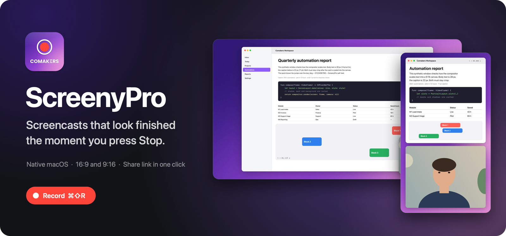
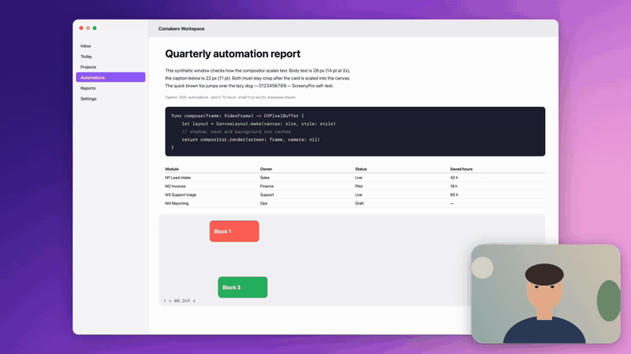
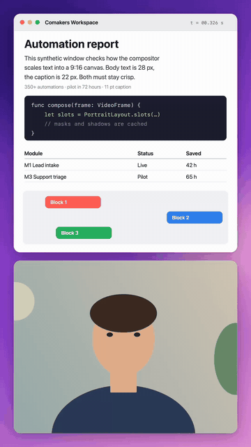
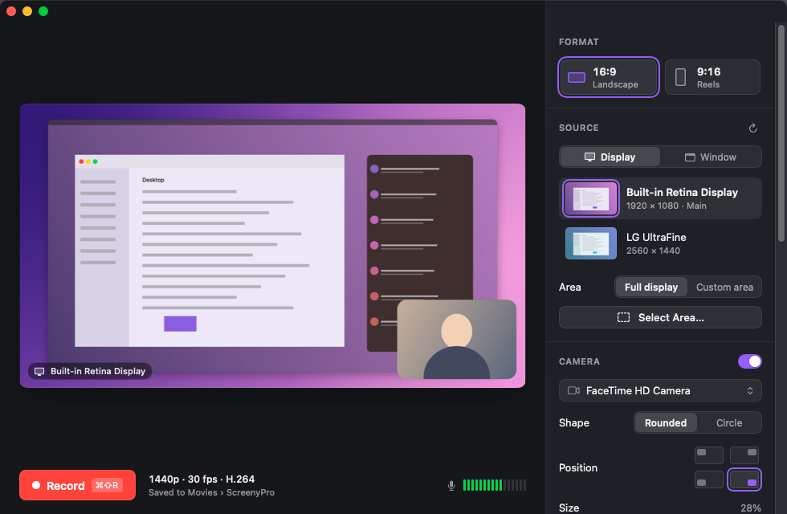
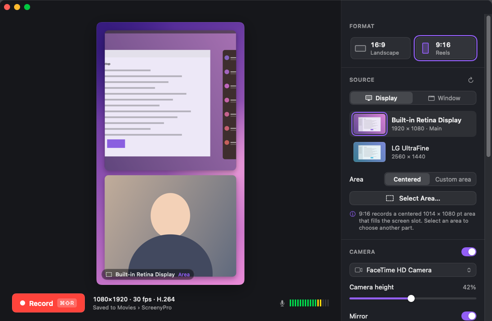
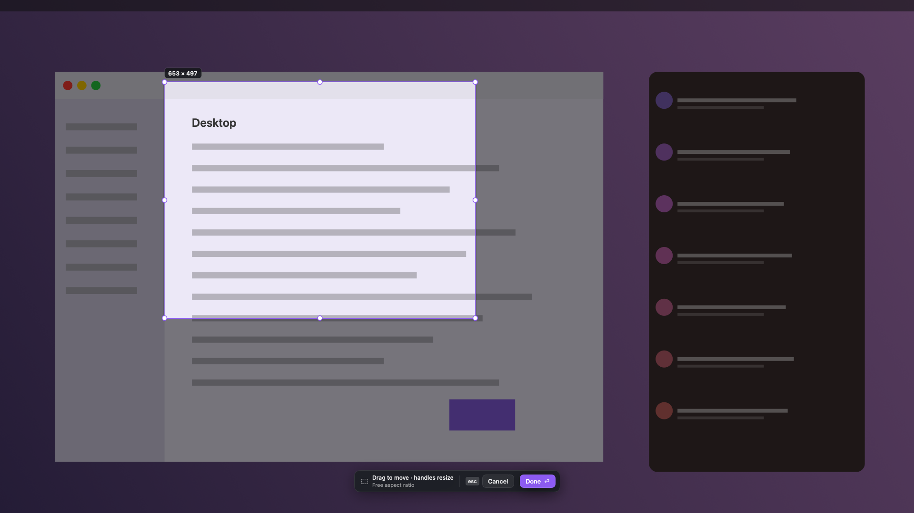
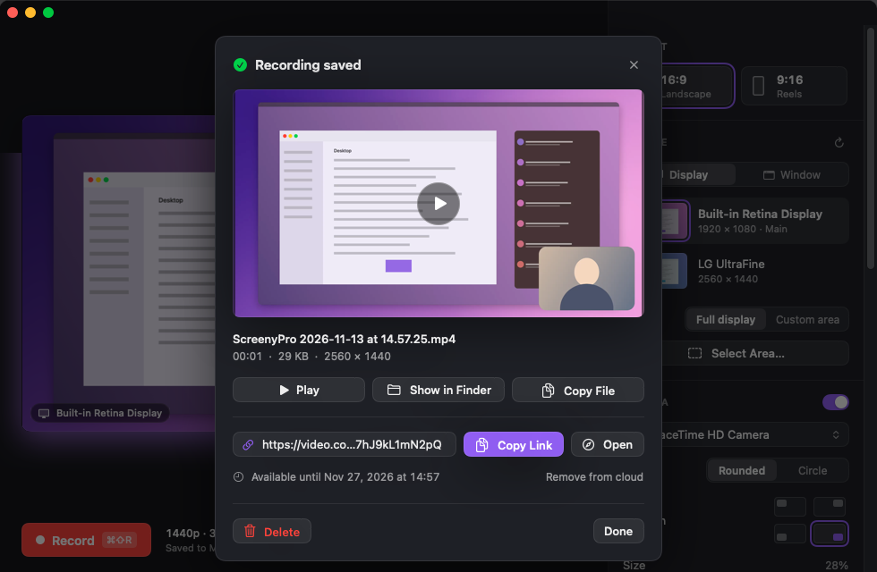
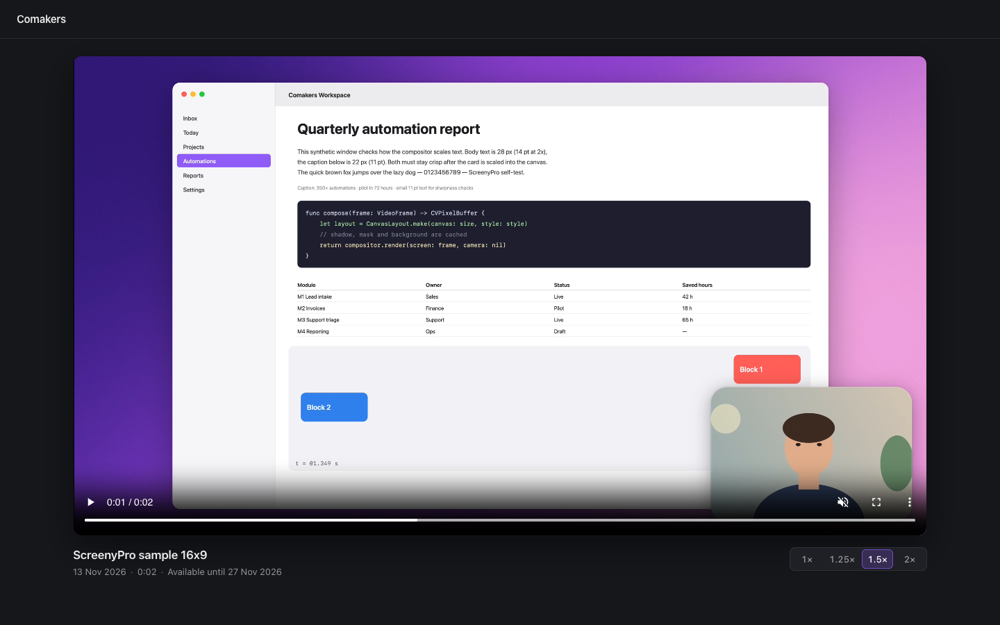
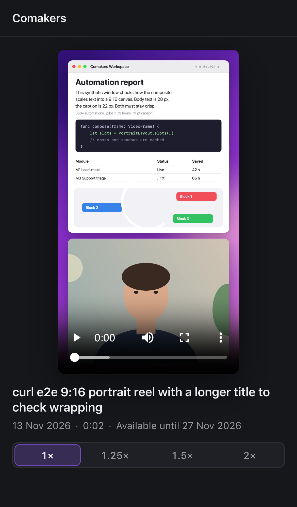
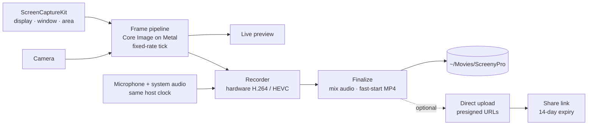

<p align="center">
  
</p>

<p align="center">
  
  
  
  
  
  <a href="LICENSE"></a>
</p>

<p align="center">
  <b>Record your screen. Press Stop. Send the link.</b><br>
  No editor, no export, no "let me just fix the background first".
</p>

---

Most screen recorders give you raw footage and an afternoon of editing. ScreenyPro composes the final picture
**while you record**: your screen as a card on a gradient, rounded corners, a soft shadow, your camera in the frame,
microphone and system audio mixed into one track. When you press Stop, a web-ready MP4 is already on disk,
and one more click turns it into a share link for your client.

Built by [Comakers](https://comakers.cz) for client walkthrough videos. Open-sourced because it turned out well.

<table>
  <tr>
    <td width="69%" align="center"></td>
    <td width="31%" align="center"></td>
  </tr>
  <tr>
    <td align="center"><sub><b>16:9</b> for client screencasts</sub></td>
    <td align="center"><sub><b>9:16</b> for Reels and Shorts</sub></td>
  </tr>
</table>

<p align="center"><sub>Actual output of the built-in self-test (synthetic content, real compositor and encoder).</sub></p>

## What you get

<table>
  <tr>
    <td width="33%" valign="top">
      <h4>Finished on Stop</h4>
      The look is rendered live, at up to 4K. What you see in the preview is exactly what lands in the file.
    </td>
    <td width="33%" valign="top">
      <h4>Any source</h4>
      A whole display, one window, or an area you draw. In 9:16 the area locks to the right aspect ratio.
    </td>
    <td width="33%" valign="top">
      <h4>Two formats</h4>
      16:9 for walkthroughs. 9:16 for Reels, with your screen on top and your camera below.
    </td>
  </tr>
  <tr>
    <td valign="top">
      <h4>Camera and sound</h4>
      Camera as a rounded card or a circle in any corner. Microphone and system audio on one clock, so they stay in sync.
    </td>
    <td valign="top">
      <h4>One-click share link</h4>
      Uploads straight to your own storage and copies a link. Videos expire by themselves after 14 days.
    </td>
    <td valign="top">
      <h4>Hard to lose a take</h4>
      Recordings are written to disk in fragments while you record, so a crash does not take the whole take with it.
    </td>
  </tr>
</table>

## The app

<p align="center">
  
  
</p>

Live preview on the left, everything else on the right: source, camera, audio, look, output.
Every change shows up in the preview at once.

<p align="center">
  
  
</p>

<p align="center"><sub>Left: pick an area of the display. Right: recording saved, link ready to paste.</sub></p>

| Shortcut | Action |
|---|---|
| <kbd>⌘</kbd> <kbd>⇧</kbd> <kbd>R</kbd> | Start / stop recording, from any app |
| <kbd>⌘</kbd> <kbd>⇧</kbd> <kbd>P</kbd> | Pause / resume |
| <kbd>⌘</kbd> <kbd>L</kbd> | Recent recordings |
| <kbd>Esc</kbd> | Cancel the countdown |

## What your client sees

<table>
  <tr>
    <td width="72%" align="center"></td>
    <td width="28%" align="center"></td>
  </tr>
</table>

A clean page with the video, nothing to install and no account. Seeking works, playback speed goes up to 2×,
and Open Graph tags give the link a proper preview in mail and messengers. Links are unguessable, pages are `noindex`,
and there is no way to list what else you have uploaded.

## Quick start

You need macOS 15+ on Apple Silicon and the Swift 6.1 toolchain. The Command Line Tools are enough; **Xcode is not required**.

```bash
git clone https://github.com/rontoday/screenypro.git
cd screenypro
scripts/install.sh        # builds and installs /Applications/ScreenyPro.app
```

On first launch grant **Screen & System Audio Recording**, then camera and microphone when macOS asks.

<details>
<summary><b>Keep macOS permissions between rebuilds</b></summary>

<br>

By default the app is ad-hoc signed, and macOS then asks for the permissions again after every rebuild.
Create a self-signed code-signing certificate named `ScreenyPro Dev` in your login keychain
(Keychain Access › Certificate Assistant › Create a Certificate, type *Code Signing*), or point
`SCREENYPRO_SIGN_IDENTITY` at an identity you already have. The build script picks it up.

</details>

<details>
<summary><b>Check the pipeline without granting anything</b></summary>

<br>

The self-test pushes synthetic frames and audio through the real compositor, encoder and finalizer:

```bash
scripts/build-app.sh
build/ScreenyPro.app/Contents/MacOS/ScreenyPro --selftest /tmp/landscape.mp4
build/ScreenyPro.app/Contents/MacOS/ScreenyPro --selftest-portrait /tmp/portrait.mp4
```

</details>

## Share links on your own infrastructure

Cloud sharing is optional and runs on **your** Vercel account. `web/` is a small Next.js app:
a bearer-protected upload API, direct-to-storage uploads through presigned URLs, and the viewer page.
Videos sit in a private Vercel Blob store and are removed by a 14-day TTL. There is no database.

1. Create a Vercel project from `web/` and connect a **private** Blob store to it.
2. Set `UPLOAD_SECRET` (any long random string) and `PUBLIC_BASE_URL` (the public origin).
   `RETENTION_DAYS` is optional, default 14.
3. Deploy. In the app open **ScreenyPro › Cloud Settings…** and enter the endpoint and the secret.

At a few short videos a day expect a few dollars a month at most: storage is billed per GB-month,
uploads are free, and expired videos delete themselves.

## How it works



The screen only produces frames when something changes, but a camera never stops moving. So the compositor runs
on its own fixed-rate clock and samples the latest screen and camera frames on every tick. That is what gives a
constant frame rate and a preview identical to the file.

| Module | Role |
|---|---|
| [`ScreenyCore`](Sources/ScreenyCore) | Models, style settings, and the protocols every other module is built against |
| [`ScreenyCapture`](Sources/ScreenyCapture) | ScreenCaptureKit stream, camera, permissions |
| [`ScreenyRender`](Sources/ScreenyRender) | Compositor, frame pipeline, recorder, self-test |
| [`ScreenyCloud`](Sources/ScreenyCloud) | Upload client: multipart, progress, cancel, Keychain |
| [`ScreenyUI`](Sources/ScreenyUI) | AppKit + SwiftUI app |
| [`web/`](web) | Viewer page and upload API |

Design notes and the module contracts live in [docs/ARCHITECTURE.md](docs/ARCHITECTURE.md).

## Status and roadmap

A working first version, used daily by its author. It is honest about what it does not do yet:

- [ ] Trim the start and end of a recording
- [ ] Zoom on the cursor and click highlights
- [ ] View notifications for share links
- [ ] Notarized builds, so you can download instead of building

Issues and pull requests are welcome.

## License

[MIT](LICENSE). The Comakers name and logo are not covered by the license: replace them in your own builds.

<p align="center">
  <sub>Made in Prague by <a href="https://comakers.cz">Comakers</a></sub>
</p>
