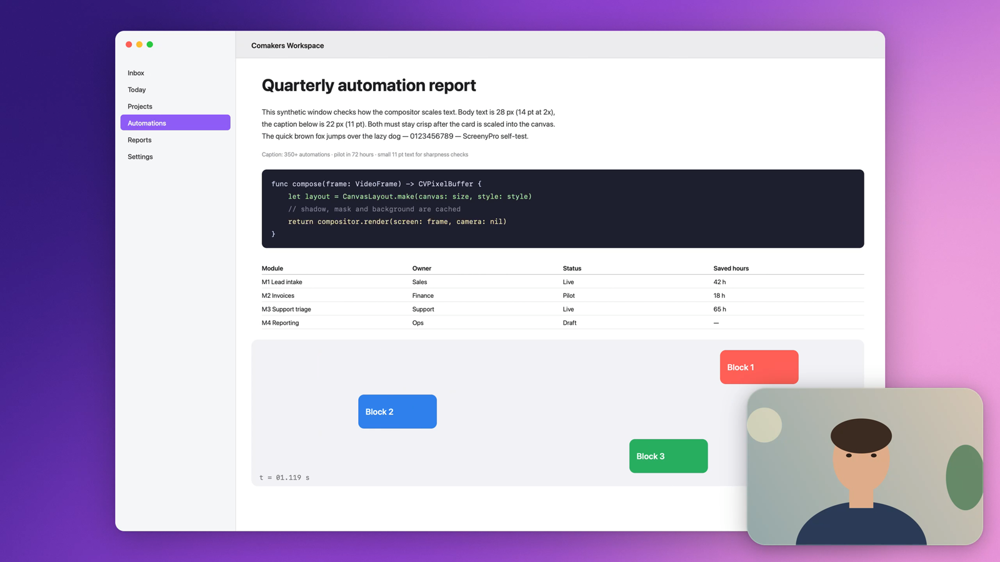
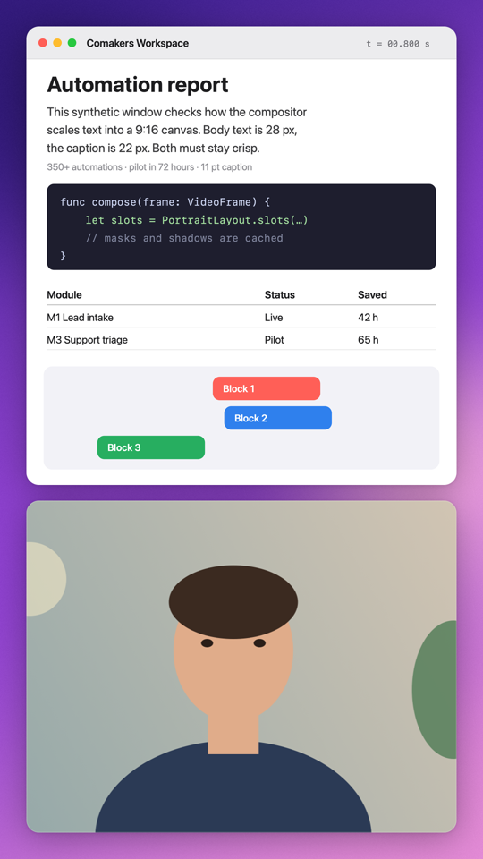

# ScreenyPro

A native macOS screencast recorder that produces a finished, styled video the moment you press Stop:
your screen on a gradient background with rounded corners and a soft shadow, your camera in the frame,
microphone and system audio mixed into one track. Then one click uploads it and copies a share link.

Built by [Comakers](https://comakers.cz) for client walkthrough videos.





*Frames from the built-in self-test (synthetic content).*

## Features

- **Live compositing.** The look is rendered during recording. No editor, no export step.
- **Sources:** a display, a single window, or an area of a display.
- **Formats:** 16:9 for screencasts, 9:16 for Reels / Shorts (screen on top, camera below).
- **Camera** overlay (rounded rectangle or circle, any corner) and **audio**: microphone + system audio.
- **Output:** web-ready H.264 or HEVC MP4, 1080p / 1440p / 4K, 30 or 60 fps.
- **Crash-safe:** recordings are written in fragments and finalized on stop.
- **Cloud sharing (optional):** direct upload to your own Vercel Blob store, a viewer page per video,
  links that expire after 14 days.
- Global hotkeys: `⌘⇧R` start/stop, `⌘⇧P` pause/resume.

## Requirements

- macOS 15 or later, Apple Silicon.
- Swift 6.1 toolchain. Xcode is **not** required: the Command Line Tools are enough.

## Build and run

```bash
scripts/build-app.sh          # builds build/ScreenyPro.app
open build/ScreenyPro.app
```

or install to `/Applications`:

```bash
scripts/install.sh
```

On first launch grant **Screen & System Audio Recording**, then camera and microphone when asked.

The app is ad-hoc signed by default, and macOS then asks for the permissions again after every rebuild.
To avoid that, create a self-signed code-signing certificate named `ScreenyPro Dev` in your login keychain
(or set `SCREENYPRO_SIGN_IDENTITY` to an identity you already have). The build script picks it up.

Check the render and record pipeline without any permissions:

```bash
build/ScreenyPro.app/Contents/MacOS/ScreenyPro --selftest /tmp/landscape.mp4
build/ScreenyPro.app/Contents/MacOS/ScreenyPro --selftest-portrait /tmp/portrait.mp4
```

## Cloud sharing

`web/` is a small Next.js app for Vercel: a bearer-protected upload API, direct-to-storage uploads through
presigned URLs, and a viewer page at `/v/<id>`. Videos live in a private Vercel Blob store and are deleted
by a 14-day TTL. There is no database.

1. Create a Vercel project from `web/` and connect a **private** Blob store to it.
2. Set the environment variables `UPLOAD_SECRET` (any long random string) and `PUBLIC_BASE_URL`
   (the public origin of the deployment). `RETENTION_DAYS` is optional (default 14).
3. Deploy, then in the app open **ScreenyPro › Cloud Settings…** and enter the endpoint and the secret.

Anyone with a link can watch that video. Links are unguessable, pages are `noindex`, and nothing can be listed.

## Project layout

| Path | What |
|---|---|
| `Sources/ScreenyCore` | Shared models, style settings and the protocols between modules |
| `Sources/ScreenyCapture` | ScreenCaptureKit stream, camera, permissions |
| `Sources/ScreenyRender` | Core Image compositor, frame pipeline, recorder, self-test |
| `Sources/ScreenyCloud` | Upload client |
| `Sources/ScreenyUI` | AppKit + SwiftUI app |
| `web/` | Viewer page and upload API |
| `docs/ARCHITECTURE.md` | Design notes and module contracts |

## Status

A working first version used daily by its author. No editing (trim, cuts), no zoom effects, no view analytics.
Builds are not notarized, so there is no downloadable release: build it from source.

## License

MIT, see [LICENSE](LICENSE). The Comakers name and logo are not covered by the license.
